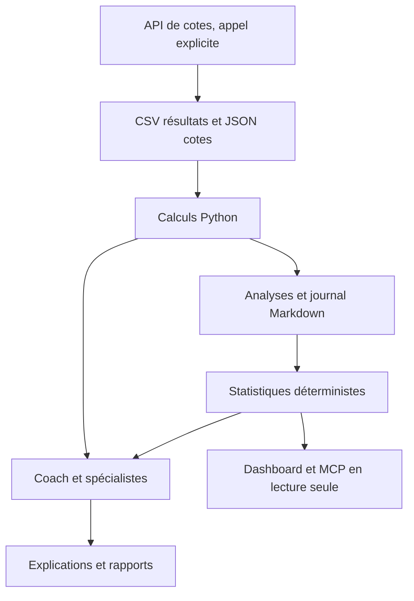

# Guide détaillé

[Retour au démarrage rapide](../README.md)

## Démarrer en local

### Dashboard multi-championnats

Depuis le projet installé :

```bash
./scripts/prono sync-leagues --markets
./scripts/prono ui --port 8876
```

Cette commande effectue une collecte explicite pour les **22 divisions nationales et 3 coupes d’Europe**
du catalogue : France, Angleterre, Allemagne, Italie, Espagne, Pays-Bas, Belgique,
Portugal, Turquie, Grèce et Écosse. Ce n'est pas une couverture mondiale.
Chaque compétition possède son historique dans `data/workspaces/` ; aucun mélange
entre championnats pour les prédictions. Les données de démonstration sont conservées.
`--leagues F1 E0` limite les imports ; `sync-markets` actualise le calendrier public
en un seul téléchargement. Les échecs et résultats sans score sont signalés.

Le tableau propose une navigation par championnat, une recherche d'équipe, les
rencontres à venir/du jour, les cotes par bookmaker, les résultats paginés, les
fréquences observées, la couverture et l'équipe IA. Le suivi des prévisions fonctionne
pendant que le dashboard est ouvert ; les résultats publics des seuls matchs suivis
sont vérifiés après match, au plus une fois par heure et par championnat.

L'onglet **Pronos** distingue aujourd'hui de **demain à J+3**, en dates locales du
workspace. Les matchs commencés sont exclus. Il montre les probabilités 1N2, l'issue
la plus probable et les motifs d'abstention. Une sélection « à étudier en fictif »
exige des cotes fraîches et horodatées, un historique suffisant, une espérance calculée
positive pour cette issue, aucun doublon au journal et une unité fictive disponible.
Les sélections sont individuelles, pas un portefeuille ou un combiné à enregistrer.
Les cotes publiques sans horodatage restent en abstention : seule une tendance
statistique indépendante des cotes est calculée à l'instant de consultation.
Aucun agent ni recherche web n'est lancé par cet onglet ; la validation du contexte
sportif reste à faire. Le modèle reste non calibré, sans avantage démontré.
Les cotes publiques sont stockées dans `data/market-watch.json` : **indicatives**,
avec date de collecte mais sans heure exacte de cotation. Elles ne sont jamais
injectées dans `fixtures.json` ou dans une simulation. `sync-odds` reste le connecteur
pour des cotes horodatées, avec clé `ODDS_API_KEY` et configuration du championnat.

### Équipe IA et actualité des clubs

Huit rôles configurables : coach, analyste sportif, analyste marché, expert bookmakers,
journaliste sportif, analyste effectif, responsable des limites et analyste performances.
Demander : « Prépare un dossier complet sur Lille–Le Havre : actualité, blessures,
suspensions, compositions et cotes, avec sources datées. »

Le skill `news` organise la lecture des sources publiques. Le journaliste distingue
annonces officielles, informations rapportées, incertitudes et contradictions ;
l'analyste effectif vérifie la portée pour le match. L'expert bookmaker contrôle les
captures et ne déduit pas un mouvement d'une seule cote.

Dans le chat intégré, choisir Local ou Claude, une période et éventuellement un match,
puis **Analyser avec les spécialistes**. L’équipe essentielle consulte le journaliste/effectifs,
l’analyste sportif puis le coach. Les renforts interviennent sur demande précise ;
l’équipe complète consulte tous les rôles activés. Chaque rôle utilise un appel distinct
au modèle choisi, puis le coach synthétise les avis. L’avancement,
les erreurs et les rapports sont visibles ; la consultation est archivée dans
`analyses/team-<identifiant>.md`. Une demande explicite de consultation peut aussi
déclencher l’équipe. Une question sur une consultation passée ne la relance pas.
La recherche est limitée à un match choisi ou à 1 à 5 rencontres issues du pré-tri Python de toute la période.
L’équipe essentielle utilise jusqu’à trois appels ; le mode complet jusqu’à huit.
Les avis réutilisés évitent de nouveaux appels spécialisés. Ces appels utilisent le quota du modèle choisi. Les spécialistes locaux
n’ont pas accès au web ; sous Claude, seuls les rôles bookmaker, journaliste et
effectifs disposent de WebSearch/WebFetch. Aucun modèle n’est appelé à l’ouverture.

Les dossiers se conservent avec `context-import FICHIER.json` et se relisent avec
`context IDENTIFIANT`, selon [le contrat de contexte](context-contract.md).
Ils apparaissent dans « Outils et données → Équipe et dossiers ». Les validations portent sur le match,
les citations présentes et les dates ; elles ne certifient pas la véracité de l'article.
Les agents ne modifient pas les probabilités du modèle à partir d'impressions.

Python **3.11+**, macOS ou Linux. Décompresser ce projet et ouvrir son dossier :

```bash
./install.sh --demo --ide claude
./scripts/prono doctor
./scripts/prono fixtures
./scripts/prono analyze demo-1 --save
./scripts/prono ui
```

Le tableau local est disponible sur **http://127.0.0.1:8766**. Ctrl+C pour arrêter.
Les matchs et résultats de démonstration sont **entièrement inventés**.
Le moteur standard n'installe aucune dépendance tierce. `--mcp` installe le SDK MCP.
L'assistant IA choisi doit être installé séparément : ce projet ne fournit pas un LLM.

```bash
./install.sh --ide claude --mcp
./install.sh --ide copilot
./install.sh --ide opencode
./install.sh --ide gemini
./install.sh --ide cursor
./install.sh --ide windsurf
./install.sh --ide all --mcp
```

Claude reçoit les agents, skills et sa configuration MCP. Copilot et OpenCode reçoivent
les agents/skills ; leur MCP est à configurer manuellement si souhaité. Gemini reçoit
des commandes TOML ; Cursor et Windsurf reçoivent les règles du workspace et utilisent
les fichiers d'agents comme instructions, sans délégation native fournie par ce projet.
L'intégration par fichiers est testée ; le fonctionnement de chacun des six assistants
n'a pas été testé en session réelle. Les fichiers existants sont conservés à la réinstallation.

Pour garder les données à part :

```bash
./install.sh --workspace ../mon-prono-prive --ide claude --mcp
./scripts/prono --workspace ../mon-prono-prive init
```

Le moteur et sa `.venv` restent dans le projet. Les prompts/configurations sont copiés
dans le workspace privé ; conserver le dossier moteur à son emplacement pour que le
chemin Python MCP reste valide. Pour actualiser un prompt déjà déployé, comparer les
fichiers et remplacer volontairement la copie : l'installateur n'écrase pas vos changements.

## Parler au coach

Ouvrir le dossier dans votre assistant de code, puis :

> « Analyse le match demo-1 et explique les écarts avec les cotes. »
>
> « Pourquoi as-tu décidé de rester en observation ? »
>
> « Enregistre en fictif la victoire à domicile du match demo-1. »
>
> « Fais le bilan de mes simulations. »

Les skills `coach-setup`, `today`, `match`, `why`, `log`, `review`, `backtest`, `news`
décrivent les procédures et commandes. Selon l'assistant, ils sont des commandes
natives ou des skills qu'il charge. Le coach ne prétend jamais avoir exécuté un
sous-agent si son assistant ne dispose pas d'un outil de délégation.

## Ce qui est implémenté

| Fonction | V1 |
|---|---|
| Équipe et mémoire | 8 agents, 8 skills, profil Markdown et configuration TOML fusionnée |
| Analyse | Baseline Poisson sur résultats passés, échantillons et limites explicites |
| Marché | Probabilités implicites, marge, normalisation hors marge, espérance estimée |
| Données | Import CSV des résultats, JSON des matchs ; connecteur The Odds API v4 |
| Simulation | Unité fixe, solde fictif, plafond d'exposition, prévention des doublons |
| Suivi | P&L, ROI, drawdown clôturé, bilan Markdown, backtest chronologique |
| Accès | CLI, dashboard local en lecture seule, MCP optionnel en lecture seule |
| Explication IA | Assistant de code ou chat CLI OpenAI-compatible, y compris Ollama |

## Commandes

### Le point quotidien

Demander au coach « Fais le point sur les matchs d'aujourd'hui », ou lancer :

```bash
./scripts/prono today
./scripts/prono today --timezone Europe/Paris --save
```

Le briefing regroupe les matchs de la journée locale, les motifs d'abstention,
le bilan fictif et les prochaines étapes. Il apparaît aussi dans le tableau local.
Le fuseau se configure avec `[coaching].timezone` dans `config/workspace.user.toml`.
Les matchs déjà commencés restent visibles mais ne sont pas analysés. Aucune API
n'est appelée ; aucune simulation n'est enregistrée. `--save` conserve un rapport
Markdown avec les calculs dans un bloc `prono`. Les probabilités disponibles restent
celles de la baseline existante, sans ajustement par le coach.

### Journal et évaluation

```bash
./scripts/prono paper-add demo-1 home --note "Test de compréhension, fictif"
./scripts/prono summary
./scripts/prono report
./scripts/prono backtest
# Résultat fourni par vous, après le coup d'envoi :
./scripts/prono paper-settle IDENTIFIANT win
# Une simulation peut être annulée avant le match :
./scripts/prono paper-settle IDENTIFIANT void
```

`home` = domicile, `draw` = nul, `away` = extérieur. Un seul pari fictif par match.
Le règlement est manuel : le logiciel ne vérifie pas le résultat sportif.
Les unités sont fictives, pas des euros. Les écritures du journal sont prévues pour
une utilisation locale séquentielle, sans plusieurs processus écrivant simultanément.

## Passer aux données réelles

Le connecteur d'historique Ligue 1 télécharge explicitement les CSV publics de
[Football-Data](https://www.football-data.co.uk/francem.php), sans clé :

```bash
./scripts/prono --workspace data/workspaces/ligue1 sync-history --seasons 2425 2526
./scripts/prono --workspace data/workspaces/ligue1 ui --port 8876
```

Initialiser d'abord un workspace distinct avec l'installateur si ce dossier n'existe
pas. L'import refuse les workspaces de démonstration et les historiques d'une autre
source. Il conserve les captures originales et leur provenance dans `data/sources/`.
Une nouvelle collecte conserve la date de première connaissance des résultats
identiques ; une correction de score bloque la mise à jour pour revue manuelle.
Les noms d'équipes restent ceux de la source : les imports de cotes doivent employer
exactement les mêmes noms. Aucun rapprochement approximatif n'est appliqué.

**Limite temporelle :** la source ne fournit pas la date de disponibilité historique
des résultats. `result_known_at` est donc la date de collecte, jamais une fin de match
estimée. Le backtest de ces seules archives évalue zéro match ; cela ne valide pas
le modèle. Les heures sont interprétées en `Europe/London`, convention d'import
explicitée dans chaque capture. Les cotes du CSV sont exclues de l'import, faute
d'horodatage exact utilisable. Le dashboard affiche ces limites.

Utiliser un workspace distinct de la démo. Importer des résultats historiques et des
cotes d'une **seule compétition**, avec des noms d'équipes strictement identiques :

```bash
./scripts/prono import-history /chemin/historique.csv
./scripts/prono import-fixtures /chemin/matchs.json
```

Ces commandes remplacent les deux fichiers de données correspondants après validation,
sans toucher aux analyses archivées ni au journal. Les formats sont dans
[docs/data-contract.md](data-contract.md).

Pour synchroniser les cotes : définir `ODDS_API_KEY` dans votre environnement local,
puis lancer explicitement :

```bash
./scripts/prono sync-odds
```

Le connecteur utilise `h2h` et les cotes décimales de The Odds API v4. Il choisit le
premier bookmaker complet par ordre de clé, sans mélanger les meilleures cotes.
`[data].sport_key` se configure dans `config/workspace.user.toml` ; le défaut est
`soccer_france_ligue_one`. Vérifier la clé de compétition auprès du fournisseur.
Chaque synchronisation peut consommer du quota, et remplace les matchs chargés.
La clé n'est pas enregistrée dans les fichiers. Le connecteur est testé sur réponses
simulées ; aucun appel authentifié réel n'a été effectué pour cette livraison.
Les résultats historiques ne sont pas récupérés automatiquement : sans CSV cohérent,
le coach s'abstient. Pas de données d'absences, compositions ou xG dans cette V1.

## Chat CLI avec votre modèle

Copier `templates/workspace.user.example.toml` vers `config/workspace.user.toml`
et saisir l'identifiant d'un modèle réellement disponible. Exemple local :

```toml
[llm]
backend = "openai-compatible"
base_url = "http://127.0.0.1:11434/v1"
model = "VOTRE_MODELE_OLLAMA"
api_key_env = "PRONO_LLM_API_KEY"
```

```bash
./scripts/prono ask "Explique mon bilan" --dry-run
./scripts/prono ask "Explique mon bilan"
./scripts/prono ask "Explique les probabilités de ce match" --event demo-1
```

Avec un fournisseur distant compatible, configurer une URL HTTPS et la clé dans
`PRONO_LLM_API_KEY`, jamais dans Git. L'appel envoie la question et le bilan agrégé ;
`--event` ajoute l'analyse locale du match. Le journal brut et le profil ne sont pas
envoyés par ce chat CLI. Un assistant de code externe peut accéder aux fichiers de
son workspace : ses réglages de confidentialité restent les vôtres.
Les réponses IA peuvent être fausses : les valeurs de la CLI font référence.
Le chat est testé avec un transport simulé, pas avec une clé réelle.

## MCP

`./install.sh --mcp --ide claude` configure un serveur stdio local.
Quatre outils : `list_fixtures`, `analyze_match`, `paper_summary`, `model_evaluation`.
Aucun outil MCP n'écrit dans le journal, ne synchronise une API ou ne place un pari.

Pour un autre client, déclarer le Python absolu `<moteur>/.venv/bin/python` avec :

```json
{
  "args": ["-m", "prono.cli", "--workspace", "/chemin/workspace", "mcp"]
}
```

Installation Python conventionnelle possible depuis les sources :
`python -m pip install -e '.[mcp]'`, puis `prono --workspace /chemin/workspace doctor`.
Le package fournit le moteur ; garder ce checkout pour l'installateur, les prompts et les modèles.

## Architecture



Voir [docs/model.md](model.md) pour les hypothèses et
[docs/references.md](references.md) pour les références examinées.

## Limites et prochaine étape

Cette livraison comprend un dashboard, un chat intégré (Ollama local ou Claude Code)
et une application macOS distribuée en DMG. Voir [docs/macos.md](macos.md) pour
l’installation et les prérequis. Pas d’app mobile, d’authentification multi-utilisateur,
de planificateur ni de notification dans cette version. Le stockage Markdown local
n'est pas chiffré par ce projet. Pas de placement de pari ou d'intégration à un compte de jeu.

L'étape suivante pour améliorer les prédictions : historiques réels et mapping d'équipes,
modèle mieux validé, comparaison chronologique aux probabilités du marché, calibration et
cotes historiques archivées. Tennis/basket nécessitent un modèle propre. Une rentabilité
sur données passées, même correctement testée, ne garantit jamais les résultats futurs.

## Vérifier et contribuer

```bash
PYTHONPATH=src python3 -m unittest discover -s tests -v
bash -n install.sh scripts/prono
```

Les tests couvrent notamment les dates de connaissance, cotes périmées, probabilités,
annulations, solde et exposition, doublons, normalisation du fournisseur et échappement HTML.
La CI est configurée pour Python 3.11, 3.12, 3.13 et 3.14. Une exécution locale
ne valide que l’environnement effectivement testé ; consulter les résultats de la CI pour les autres versions.

Licence MIT. Les données utilisateurs ne doivent pas être publiées avec le moteur.


## Suivi et comparaison des modèles

**Mes pronos suivis** conserve les prévisions avant match dans des blocs `forecast`
sous `analyses/`. Les résultats sourcés sont des blocs `forecast_outcome` séparés :
aucune prévision ni date originale n'est remplacée. Le journal de mises fictives reste
inchangé. Le suivi calcule Brier, log loss et proportion de choix corrects une fois les
résultats connus. Les données synthétiques sont exclues du bilan réel.

Le suivi local passe toutes les cinq minutes lorsque le dashboard est actif. Les
résultats publics ne sont téléchargés que pour les matchs suivis depuis au moins trois
heures, à raison d'un essai par championnat et par heure. Il n'utilise ni API de cotes
payante ni modèle de langage. Les erreurs sont visibles ; fermer l'app arrête le suivi.
Désactiver avec `[tracking] enabled = false` dans `workspace.user.toml` ; désactiver les
seuls imports avec `auto_refresh_results = false` dans cette même section.

**Évaluation** compare la baseline, une variante à récence pondérée et une correction
de type Dixon–Coles, plus une référence par fréquences de championnat. Les derniers
20 % des matchs forment la période de test ; les variantes sont ré-estimées sur le
passé. L'étude des archives utilise un embargo de 24 h entre résultats d'entraînement
et matchs évalués, sans réécrire `result_known_at`. Cette hypothèse de recherche ne
reconstitue pas la publication historique. Le mode strict conserve les dates réelles
de connaissance et peut n'évaluer aucun ancien match. Les scores, la calibration
et les intervalles par semaines sont descriptifs. Aucune promotion automatique des
variantes, aucun ROI historique sans cotes pré-match horodatées.

```bash
.venv/bin/python -m prono.cli track
.venv/bin/python -m prono.cli track --refresh-results
.venv/bin/python -m prono.cli tracking
.venv/bin/python -m prono.cli evaluate --leagues F1 F2 E0
.venv/bin/python -m prono.cli evaluate --leagues F1 --mode observed
```

Le registre `data/match-registry.json` garde les identifiants des rencontres lors d'un
changement d'horaire futur non ambigu et conserve les révisions. Une association ambiguë
ou après le début du match exige une confirmation explicite :
`prono schedule-link ANCIEN_ID NOUVEL_ID`. Les anciennes prévisions sont alors exclues
du bilan et restent lisibles. Les noms alternatifs de clubs s'indiquent explicitement
par championnat dans `data/team-aliases.json`, par exemple `{"F1":{"psg":"paris sg"}}`.
Les captures brutes restent conservées. Les différences de cotes sont des variations
entre collectes, sans heure de cotation inventée.

Le chat propose **Adaptées à la demande** ou **Équipe complète**. Les avis web sourcés
peuvent être réutilisés pendant 30 minutes, 10 minutes maximum près du coup d'envoi,
avec leur date et leur origine visibles. **Rechercher à nouveau** ignore ce cache.
Les faits ou prompts modifiés invalident le cache. Le chat montre les appels, avis
réutilisés, durée et tokens lorsqu'ils sont rapportés par le fournisseur ; aucun coût
ou quota restant n'est estimé.


## Sélection des matchs à approfondir

Python examine
toute la période et trie avant la limite de 30 fiches détaillées du chat. Par défaut, il
exige un choix à au moins 50 %, un écart d’au moins 10 points avec la deuxième issue,
au moins huit matchs par équipe sur les deux dernières années et un dernier résultat
historique dans les 180 derniers jours. Ces seuils de pré-tri sont configurables dans
`[selection]` et ne constituent pas une validation du modèle.

Les candidats fictifs avec cotes vérifiées et espérance théorique positive passent
d’abord, par espérance décroissante. Les autres rencontres admissibles sont des
observations, triées par probabilité Python, écart puis échantillon récent. L’heure ne
sert qu’à départager. Les cotes indicatives n’autorisent aucun classement par rentabilité.

Le chat affiche la liste proposée, les critères et les exclusions avant de lancer les
agents. On peut demander de un à cinq matchs ; une liste insuffisante n’est pas remplie
avec des choix faibles. Un match manuel reste possible et conserve ses avertissements.
La règle, les rangs et les exclusions sont archivés avec chaque nouvelle consultation et
restitués dans ses traces serveur. Les anciennes archives ne sont pas réécrites.

Ce pré-tri sert à choisir les matchs à approfondir. Les spécialistes consultent uniquement
ce périmètre et le coach peut écarter un choix après leurs avis sourcés. Aucun combiné
optimal ni probabilité jointe n’est calculé. Aucun appel au modèle n’est fait par l’aperçu.


## Historiques nationaux et européens

Les championnats nationaux utilisent par défaut cinq ans de résultats ; les coupes UEFA, dix ans, dans des historiques séparés par compétition. `[domestic].history_years` et `[europe].history_years` règlent les imports ; `[model].max_history_days` et `[europe].max_history_days` règlent leurs fenêtres de calcul. Une configuration utilisateur propre à une coupe prime sur les valeurs par défaut.

La forme nationale des clubs engagés en Europe est un contexte descriptif : 5 et 10 derniers matchs, buts pour/contre et bilans domicile/extérieur sur 180 jours. Un résultat ancien de plus de 21 jours est signalé. Les clubs sont reliés par noms exacts ou correspondances explicites ; une identité ambiguë reste indisponible. Ce contexte ne comble pas un historique européen insuffisant et ne modifie pas la baseline.

Les résultats européens acceptés sont confirmés à 90 minutes ; prolongations, tirs au but et heures incertaines sont exclus. Le calendrier et les cotes publiques se synchronisent explicitement avec `sync-leagues --leagues UCL UEL UECL`. Les cotes sans heure de cotation vérifiable restent indicatives et ne permettent aucune simulation.

Le MCP lit uniquement le workspace indiqué dans sa configuration. Il ne consolide pas les sous-workspaces par compétition et ne représente pas le bilan prospectif global : une réponse vide à la racine ne prouve pas une absence de prévisions suivies.
